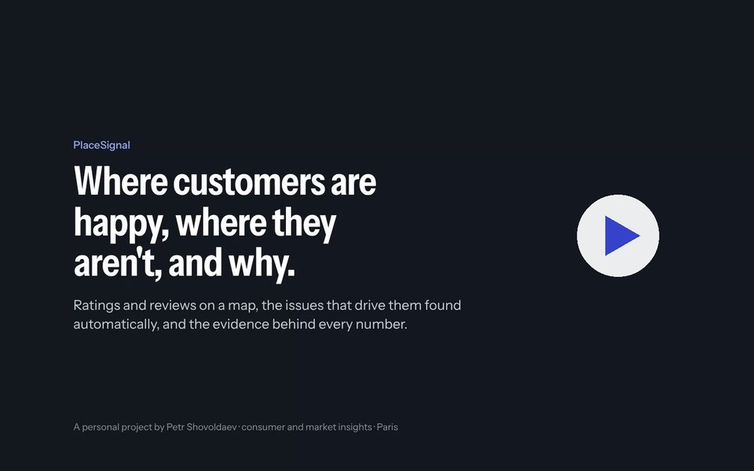
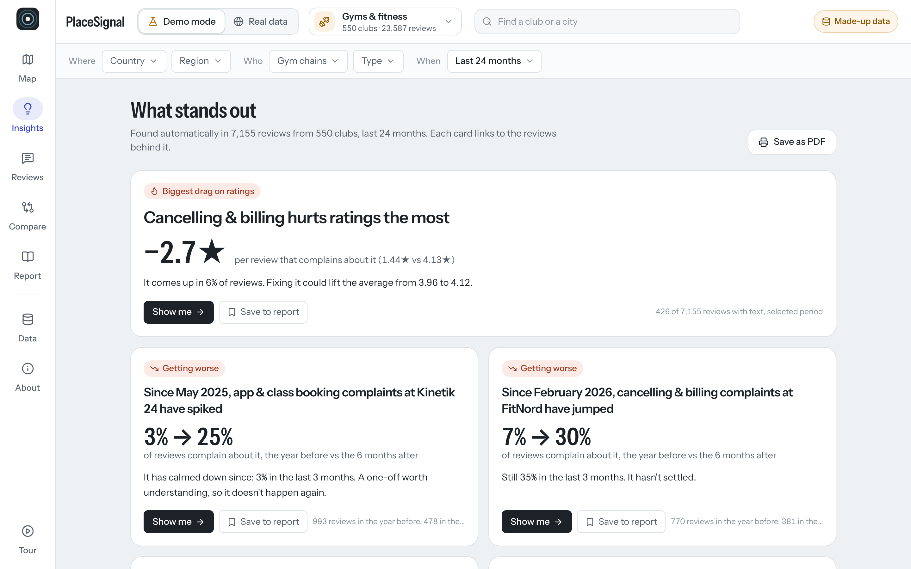
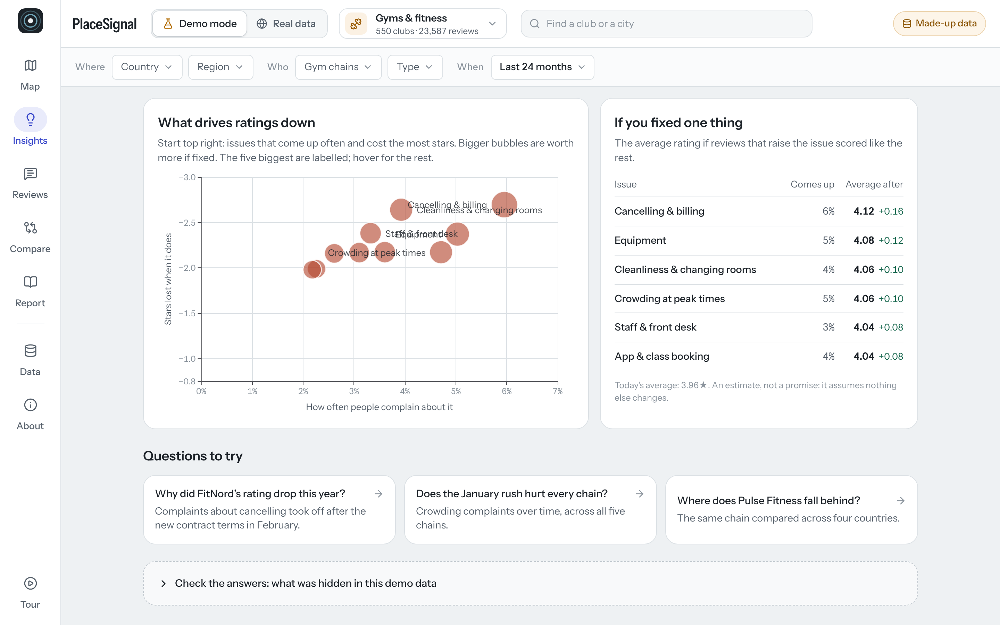
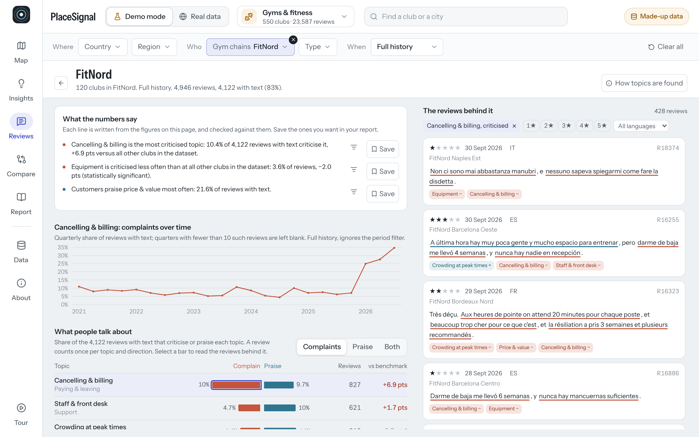
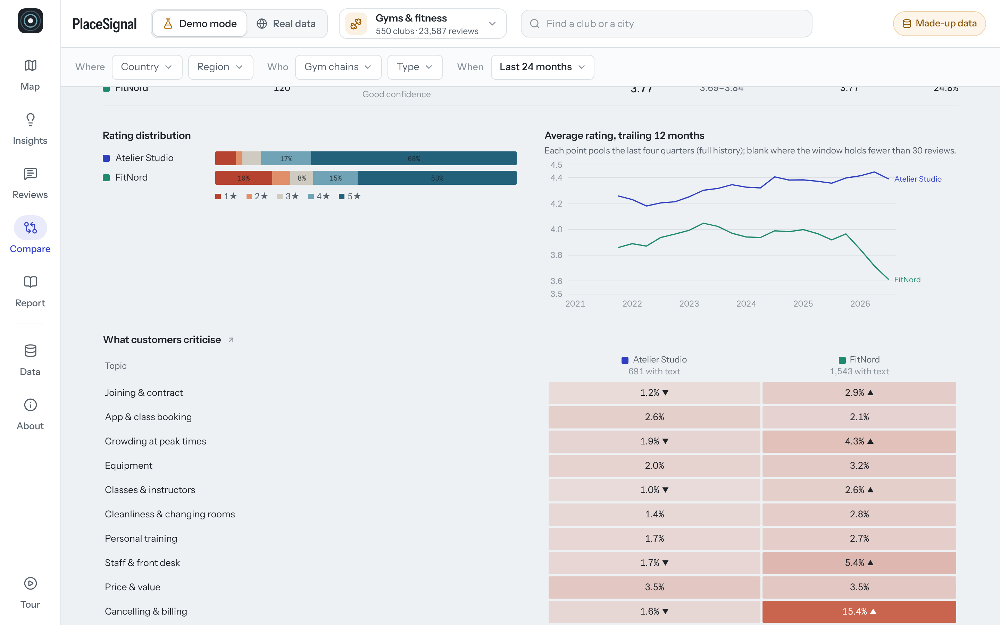
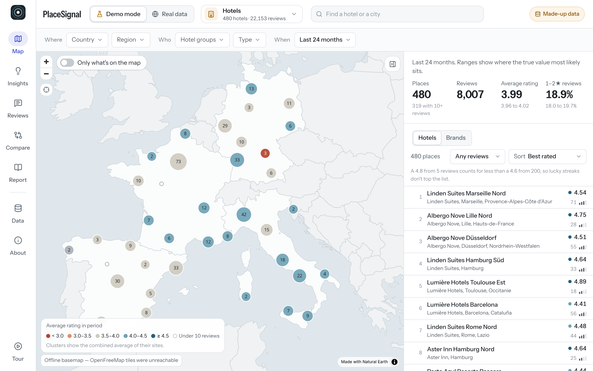
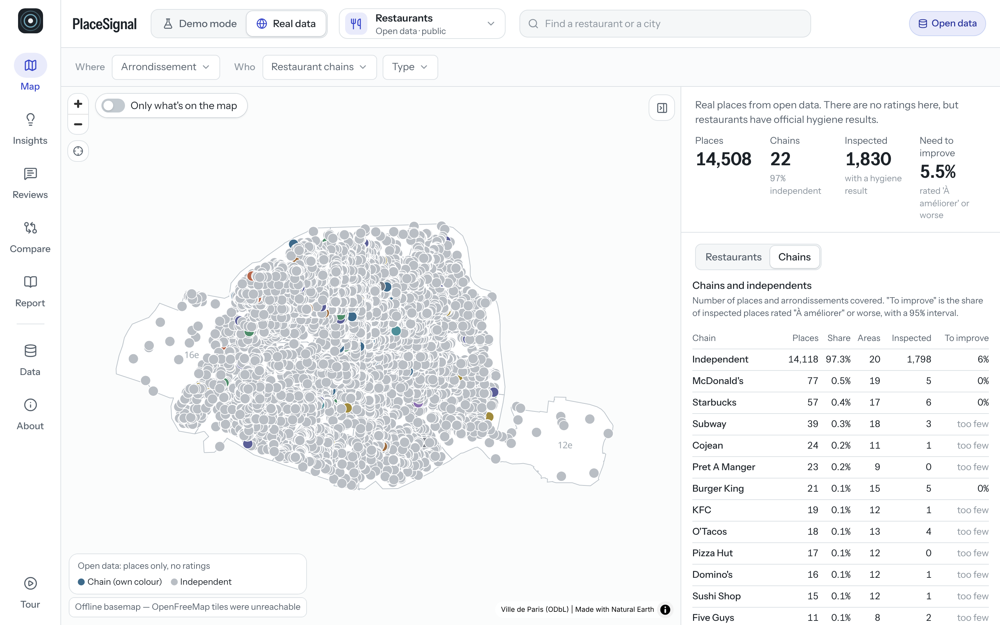

# PlaceSignal

**Where customers are happy, where they aren't, and why.**

PlaceSignal puts ratings and reviews on a map, finds what drives them, and shows the reviews behind every number.
I built it on my own, end to end, to show how I take a business question from raw customer feedback to an answer
a manager can act on.

*Petr Shovoldaev · 12+ years in consumer and market insights · Paris · [LinkedIn](https://www.linkedin.com/in/pshovoldaev/)*

▶ **[Watch the walkthrough (2:48)](videos/placesignal-overview.mp4)**: gyms in depth, then hotels, fast food,
fashion and 14,500 real Paris restaurants.

---

## The idea in one minute

A chain with 500 locations gets thousands of reviews a month. Reading them doesn't scale, and an average star rating
doesn't say what to fix. PlaceSignal answers the questions an insights or operations team would actually ask:

| Question | What PlaceSignal shows |
|---|---|
| What costs us the most stars? | Each issue ranked by how often it comes up × how many stars it costs, and what fixing it is worth |
| What changed, and when? | Complaints that jumped after a specific month, found in the data with no date given to it |
| Who already does it better? | The brand with the fewest complaints on the same issue, over the same period: a fix to copy |
| Is it everywhere or just here? | Countries or regions that fall behind the rest of the brand, with a significance test |
| Is it real or just noise? | Every rate has a sample size and a confidence interval; small samples are flagged, not hidden |
| Show me. | One click from any number to the reviews behind it, in five languages, with the key phrases highlighted |

It ends with a printable report: the findings, how they were worked out, and what the data can and can't say.

## Screenshots

| | |
|---|---|
|  **Insights**: what stands out, found automatically, each with its numbers |  **Drivers**: how often an issue comes up vs. how many stars it costs |
|  **Evidence**: the reviews behind a finding and its timeline |  **Compare**: brands side by side, topic by topic |
|  **Map**: every location coloured by rating, ranked fairly |  **Real data**: 14,500 Paris restaurants from open data |

## One video per industry

Same app, same method, a different story in each. Each runs under two minutes.

| Industry | What the analysis finds | Video |
|---|---|---|
| Car dealerships | Poor updates and follow-up cost the most stars; delivery complaints spiked at one brand from March 2024 | [▶ automotive](videos/industry-automotive.mp4) |
| Casual dining | Price and portions cost the most stars; one burger chain's complaints jumped after April 2025, and who to learn from | [▶ restaurants](videos/industry-restaurants.mp4) |
| Fast food | Self-order kiosks: faster queues, but more wrong orders. A trade-off, found on its own | [▶ fast food](videos/industry-fast_food.mp4) |
| Fine dining | Cuisine complaints jumped at one group from June 2025 (its head chef had left); a price rise at another | [▶ fine dining](videos/industry-fine_dining.mp4) |
| Supermarkets | Self-checkout: shorter queues, angrier machines; a supply problem that came and went | [▶ supermarkets](videos/industry-supermarkets.mp4) |
| Fashion | A stricter returns policy and what it cost; click & collect, before and after the fix | [▶ fashion](videos/industry-fashion.mp4) |
| Hotels | A renovation that cost guests their sleep, then paid off | [▶ hotels](videos/industry-hotels.mp4) |
| Gyms | Cancelling a membership is the worst experience; new contract terms at one chain made it worse | [▶ gyms](videos/industry-gyms.mp4) |
| Beauty salons | Running late costs the most stars; complaints about pressure to buy jumped at one chain after its new sales targets | [▶ beauty](videos/industry-beauty.mp4) |
| Barbers | Haircut quality costs the most stars; online booking ended the walk-in queues at one chain, a price rise hurt another | [▶ barbers](videos/industry-barbers.mp4) |

## AI that costs nothing to run

- **An open-source model on a laptop does the reading.** Qwen 2.5 (7B), running locally through Ollama, read 5,972 real
  reviews of Paris restaurants. No AI subscription, no per-review fees, and the text never left the machine.
- **Measured, not assumed.** Against 200 reference-labelled reviews it finds **79% of complaints, against 46%** for a
  hand-written rule set, with the same precision (65%). It also over-counts complaints about price and atmosphere about
  2×, so the app lets the model *read* and keeps every number computed by code.
- **It finds what nobody was tracking.** Asked what customers mention outside the standard topics, it surfaced heat and
  missing air conditioning: rare, but when it comes up the rating drops from 4.6★ to 3.1★. Cheap to fix, invisible in a
  fixed topic list.
- **It writes the summary, and can't make numbers up.** A one-click summary for a manager, written by the local model.
  Every number in it is checked against the data; an answer with an invented number is rejected.

## Built to run inside a company

- **Same setup, company infrastructure.** The app and the open-source model can run where the company's data already
  lives: a data platform such as Snowflake (which can host containerised apps and run open-source models on its own
  compute) or any internal server. Employees open a link and run their own analysis.
- **No per-query AI bill.** There is no AI vendor charging per review or per question; the cost is the compute the
  company already runs. Customer feedback stays inside the company's environment.
- **Live, not quarterly.** A review takes the model a few seconds, so feedback the company owns (its own review profiles,
  app-store reviews, survey and NPS verbatims, complaints) can be read and analysed as it arrives, not in a quarterly batch.

## Honest about the data

- **Demo mode** uses made-up brands and generated reviews: 52 brands, 6,400 locations and 260,000 reviews in English,
  French, German, Spanish and Italian. Real stories were planted in it (a policy change, a launch, a regional problem), so the
  app can show whether the analysis finds them without being told. It does, and the app shows the answers next to the
  findings. Everything that's made up is labelled as made up, on every screen.
- **Real data** shows actual places in Paris from open data: 14,500 restaurants from OpenStreetMap, matched to the
  official hygiene inspections (Alim'confiance), plus barbers, hair salons and car dealerships. Open data has no
  ratings, and the app says so instead of inventing them.
- On my own computer, real data mode can also read a small private snapshot of Google ratings and reviews for live demos.
  It is never published, and it isn't in this repository or in these videos.
- Every source declares what it may be used for, and the app enforces it: data that can't be published can't be exported
  or deployed.

## How it works

- **Statistics first, words second.** Every number is computed (rates with Wilson intervals, review-weighted averages with 95%
  intervals, a ranking that doesn't reward a handful of lucky reviews, Welch tests for regional gaps, step-change
  detection for "what changed when"). The sentences are written from those numbers and checked against them.
- **Review analysis in five languages**, by a transparent rule set or by the local AI model. Both are scored against
  labelled text, per topic, because a reader with a good overall score can still badly miscount a topic.
- **No servers, no paid services.** A static web app (React, TypeScript, MapLibre, ECharts), a Python data pipeline and
  an open-source model through Ollama. Running cost: €0.
- **Tested.** Unit tests for every metric, an end-to-end test suite of the main journeys, and the videos themselves are
  recorded by scripts, so they can be re-made after any change.

## About me

I've spent 12+ years in consumer and market insights. I like questions that start messy ("why are our ratings
falling?") and end with something a team can act on. PlaceSignal is how I'd approach that today: clear questions,
honest statistics, data used within its rights, and a tool people can use without a manual.

**Let's talk:** [linkedin.com/in/pshovoldaev](https://www.linkedin.com/in/pshovoldaev/)

*PlaceSignal is a personal project. It is not affiliated with any employer, and no employer data was used.*
